# Beyond Length Generalization: The Data Efficiency of Positional Encodings at Sentence Scale

**Abdourahmane Iraoui** · University of Toronto

RoPE is usually justified by *length generalization*. But it is also the default at **sentence scale**, where inputs are a few dozen tokens and nothing is extrapolated. This repo tests whether RoPE still helps there, using an encoder–decoder transformer for machine translation (WMT14).

## TL;DR

- **RoPE needs 8–14% less training data than sinusoidal encodings to reach the same validation loss.** This holds in all five configurations (two widths (d=256 and d=512), two learning rates, a modernized architecture, two language pairs (en-fr and en-de)), and the saving does not shrink late in training.
- **Learned absolute embeddings have a 5–6% advantage over sinusoidal encodings.** 
- **T5 relative bias, end up as data-efficient as RoPE.** However, interestingly, it *starts behind sinusoidal* and only catches up after about half of training.
- **BLEU doesn't show these differences.** Final BLEU differences are 0.2–0.4 points (within noise). We measure data efficiency over the whole training curve (the loss) instead.

<p align="center">
  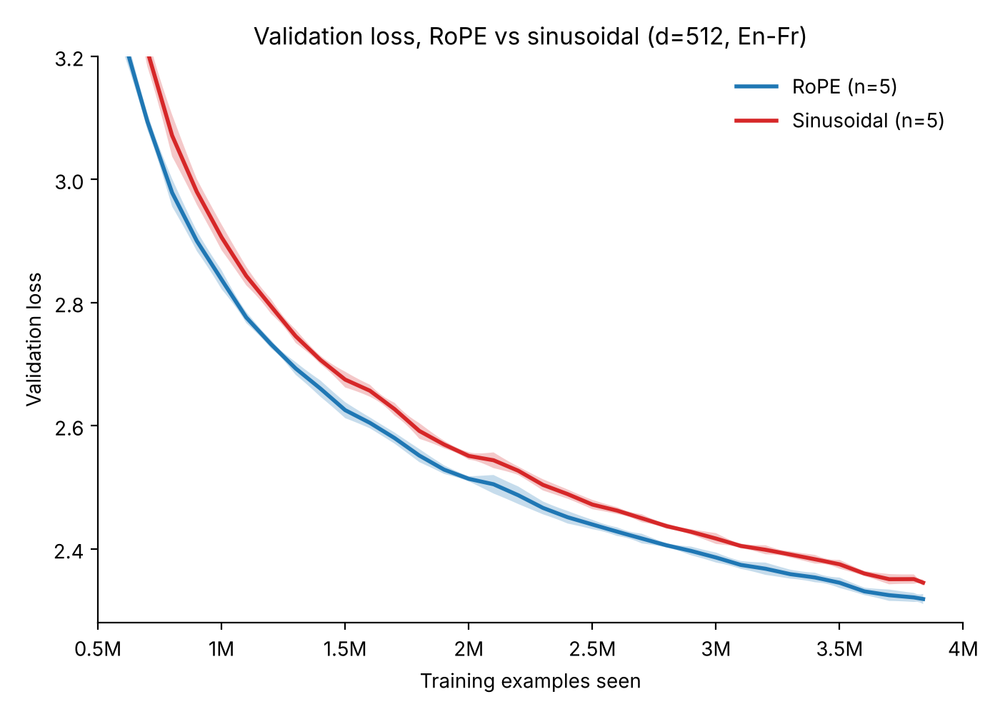
  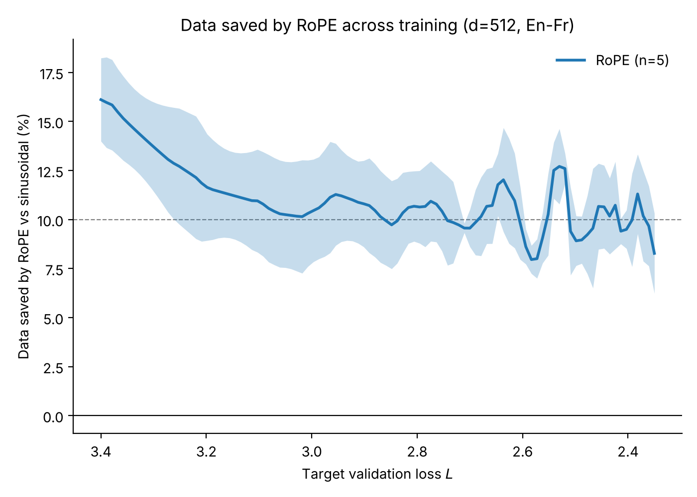
</p>

*Left: validation loss for RoPE and sinusoidal at d=512, En→Fr (mean ± 1 SD over 5 seeds). The curves converge, so a final-checkpoint doesn't show the real differences. Right: the same runs expressed as data saved by RoPE. The saving starts around 16% and settles near 10% through the deepest loss reached.*

---

## Contents

1. [Research questions](#1-research-questions)
2. [Why final BLEU and final loss can't answer them](#2-why-final-bleu-and-final-loss-cant-answer-them)
3. [The metric: data saved](#3-the-metric-data-saved)
4. [Experimental setup](#4-experimental-setup)
5. [Result 1: RoPE is consistently more data-efficient](#5-result-1-rope-is-consistently-more-data-efficient)
6. [Result 2: Locating the baseline (learned absolute, NoPE)](#6-result-2-locating-the-baseline)
7. [Result 3: Relative information and how it is obtained (T5 vs RoPE)](#7-result-3-relative-information-and-how-it-is-obtained)
8. [BLEU](#8-bleu)
9. [Limitations](#9-limitations)
10. [Reproducing everything](#10-reproducing-everything)
11. [Repository layout](#11-repository-layout)

---

## 1. Research questions

- **RQ1.** Does RoPE beat sinusoidal encodings at sentence scale, and does it do so consistently across seeds?
- **RQ2.** Is the advantage robust to width, learning rate, architecture and language pair?
- **RQ3.** Does the advantage come from relative position information in general, or specifically from the way RoPE supplies it?

**Answers:** (RQ1) yes, about 10% data saved; (RQ2) yes, 8–14% in every configuration tested; (RQ3) both: learned absolute embeddings never achieves the same efficiency as ROPE while the T5 relative bias takes more time but eventually becomes as efficient.

## 2. Why final BLEU and final loss can't answer them

**BLEU is too coarse.** At the end of training, RoPE, T5 bias and learned absolute reach 28.00, 28.10 and 28.07 BLEU. The RoPE vs sinusoidal gap is +0.30. Published work shows BLEU deltas of 1–2 points are often unreliable, so our 0.2–0.4 point difference doesn't allow us to compare them.

**A final-loss gap doesn't mean the same thing at different depths.** Loss falls sublinearly. A 0.02 gap between 3.00 and 2.98 is a small step, but the same gap between 1.90 and 1.88 is a large one. That makes a final-checkpoint loss gap hard to interpret and impossible to compare across datasets or model sizes.

So we need a quantity that is defined throughout training and means the same thing wherever it is measured.

## 3. The metric: data saved

Instead of asking "which model has the lower loss at the end?", we ask: **to reach a given validation loss, how much less training data does RoPE need than sinusoidal?**

A real example (d=512, En→Fr, seed 0): the sinusoidal model first reaches a validation loss of 2.5 after 2.30M training examples, and the RoPE model reaches it after 2.07M. RoPE needed about 10% less data to get there, so the **data saved at loss 2.5 is 9.6%**.

We repeat this at every loss level along the way, which gives a curve: data saved as a function of the target loss (the right panel of Figure 1). Details:

- Validation loss is measured every 100K training examples. Between two checkpoints we interpolate linearly to find where a target loss was crossed.
- We use the best loss reached so far, so a noisy checkpoint can't make a run "un-reach" a loss it already hit.
- The comparison is always **seed against seed**: RoPE seed 0 vs sinusoidal seed 0, and so on. Both runs see exactly the same data in the same order, so most of the seed-to-seed noise cancels. This matters because the effects are about as large as that noise.

Why this is better than comparing final losses: a 10% saving means the same thing early in training as late in training, whereas a 0.02 gap in loss does not. And because it is a curve rather than a single number, it shows *when* an advantage appears, which is how the T5 result in §7 shows up.

**One number per configuration.** To get a headline number, we average the data saved over the end of training: it’s less noisy than any single point, and it’s where the models are closest to their final quality. Each number in Table 1 is that average with a 95% confidence interval across seeds. For example, say the RoPE runs end at a loss of 2.3 and the worst sinusoidal run ends at 2.4. We can only compare down to 2.4, since below that the sinusoidal model has no data. So we average the data saved over losses from 2.4 to 2.65, the last 0.25 of loss. How much of the end of training to include is a choice we had to make, so Table 1 also shows the last 0.15 (2.4 to 2.55) and the last 0.35 (2.4 to 2.75). All three give nearly the same answer.

**Table 1: % data saved by RoPE over sinusoidal [95% CI], averaged over the last 0.15, 0.25 or 0.35 points of loss reached in training**

| Configuration | n | 0.15 | **0.25** | 0.35 |
|---|---|---|---|---|
| d=512, En→Fr | 5 | 9.8 [8.2, 11.5] | **9.9 [8.5, 11.3]** | 10.2 [8.6, 11.7] |
| d=256, higher LR | 5 | 13.5 [9.5, 17.4] | **13.8 [10.2, 17.4]** | 14.1 [10.3, 17.9] |
| d=256, matched LR | 5 | 12.1 [8.9, 15.4] | **12.6 [9.7, 15.6]** | 12.8 [10.1, 15.4] |
| d=512, modern arch | 3 | 8.4 [6.2, 10.6] | **8.2 [6.5, 10.0]** | 8.3 [6.3, 10.4] |
| d=512, En→De | 3 | 10.9 [5.0, 16.8] | **10.9 [5.8, 16.0]** | 11.1 [5.6, 16.6] |

Changing (how much of the end of the training we will average over) the width from 0.15 to 0.35 points of loss moves no estimate by more than 0.7 points, and every interval excludes zero.

**A caveat.** Both models use the same learning-rate schedule, set specifically for the full training run. The number answers: "if you train with this schedule and stop as soon as you hit the target loss, how much data do you save?" If you instead re-tuned the schedule for a shorter run, that would mostly help the model that stops earlier (RoPE), so the reported savings are probably conservative.

Implementation: [`analysis/data_efficiency.py`](analysis/data_efficiency.py), about 40 lines.

## 4. Experimental setup


**Data.** We train on WMT14 English→French, with English→German as a second pair to check that the results generalize. Every run makes a single pass over the same ~3.8M sentence pairs in the same order, so differences between runs come from the model rather than the data, which is what makes the seed-by-seed comparison work, we compute the validation loss on a heldout 1% of the dataset.

**Sentence scale.** Sequence length, max(|src|, |tgt|) in subwords: median 35, p90 71, p95 89, p99 143. That is orders of magnitude below the 2–8K-token regime where RoPE is usually studied.

**Model.** Pre-LN encoder–decoder Transformer with 6+6 layers, feed-forward width 4× the model width, and tied embeddings. d=512 uses 8 heads (60.5M params); d=256 uses 4 heads (19.2M params). We train a single epoch with no dropout, Adam (β = 0.9, 0.98), the inverse-square-root schedule with 10% warmup, label smoothing 0.1, grad clipping at 1.0, batches of 256 length-bucketed sentences, and bf16 autocast (RoPE rotation in fp32).

**The five encodings.**

| | Absolute | Relative |
|---|---|---|
| **Fixed** | Sinusoidal (baseline) | RoPE (q, k in every self-attention layer, base 10⁴) |
| **Learned** | Learned APE (a learned vector per position, up to 300; init std 0.7) | T5 bias (32 distance buckets, max distance 128; init std 0.02) |

We also include NoPE (no positional signal at all). For all encodings, cross-attention never receives a positional encoding.

**The five configurations** (RoPE vs sinusoidal in each):

| Configuration | Seeds | What it varies |
|---|---|---|
| d=512, En→Fr | 5 | reference |
| d=256, higher LR | 5 | width (the schedule scales the learning rate up for smaller models, so peak LR ≈1.6e-3) |
| d=256, matched LR | 5 | width with peak LR held at the d=512 value (≈1.1e-3) |
| d=512, modern arch | 3 | AdamW, warmup–cosine decay, SwiGLU, RMSNorm (58.9M params) |
| d=512, En→De | 3 | language pair |

[`data/experiments.csv`](data/experiments.csv) maps every experiment ID to its configuration.

## 5. Result 1: RoPE is consistently more data-efficient

<p align="center">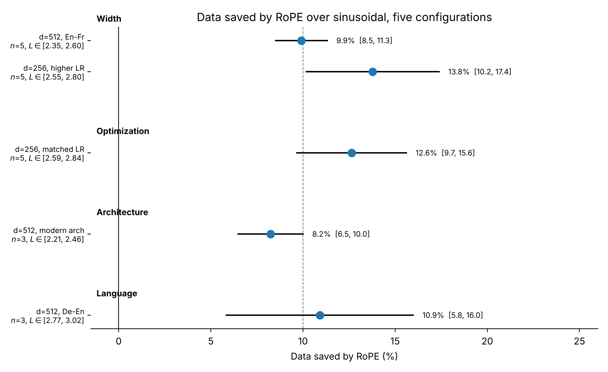</p>

*Figure 2: data saved by RoPE over sinusoidal (mean over seeds, 95% confidence interval).*

- **Every interval excludes zero.** It ranges from 8.2% to 13.8%.
- **The saving does not decay** 
- **Learning rate is not the explanation.** At d=256, holding the peak LR at the d=512 value barely changes the estimate (12.6% vs 13.8%).
- **What this does not show.** The d=256 rows sit above the d=512 rows, which hints at a width effect. But the intervals overlap and there is no formal test across configurations, so treat it as a suggestion only.

<details>
<summary>Per-configuration data-saved curves</summary>
<p align="center">
  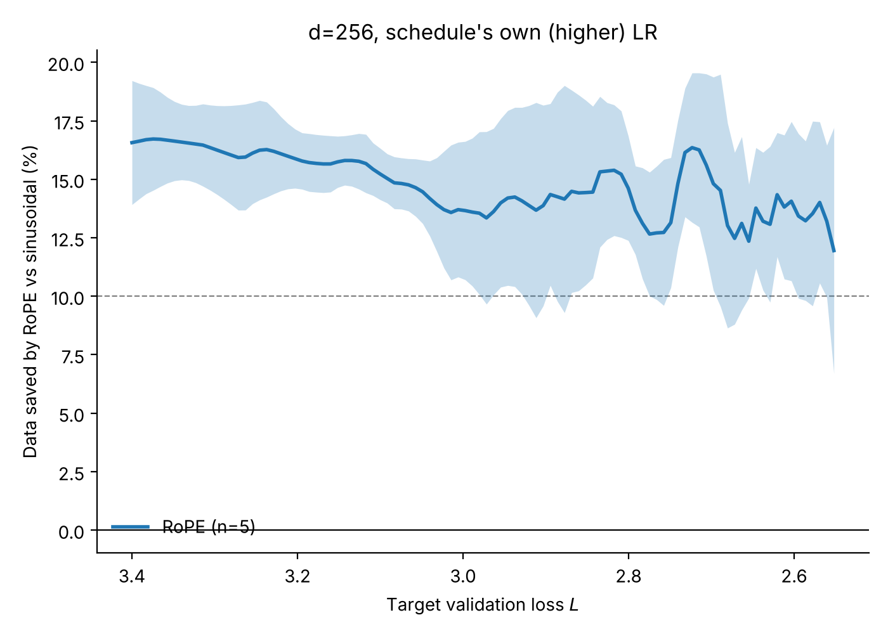
  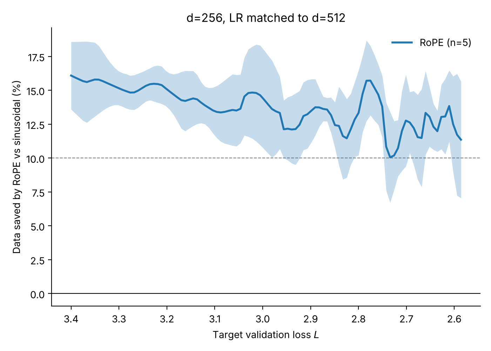
  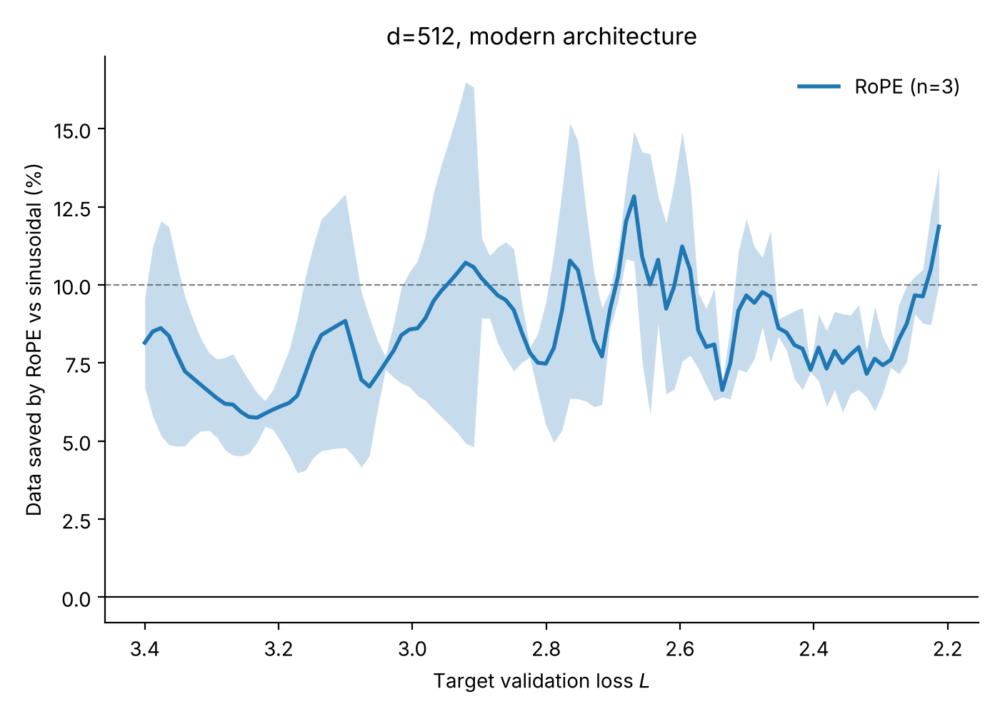
  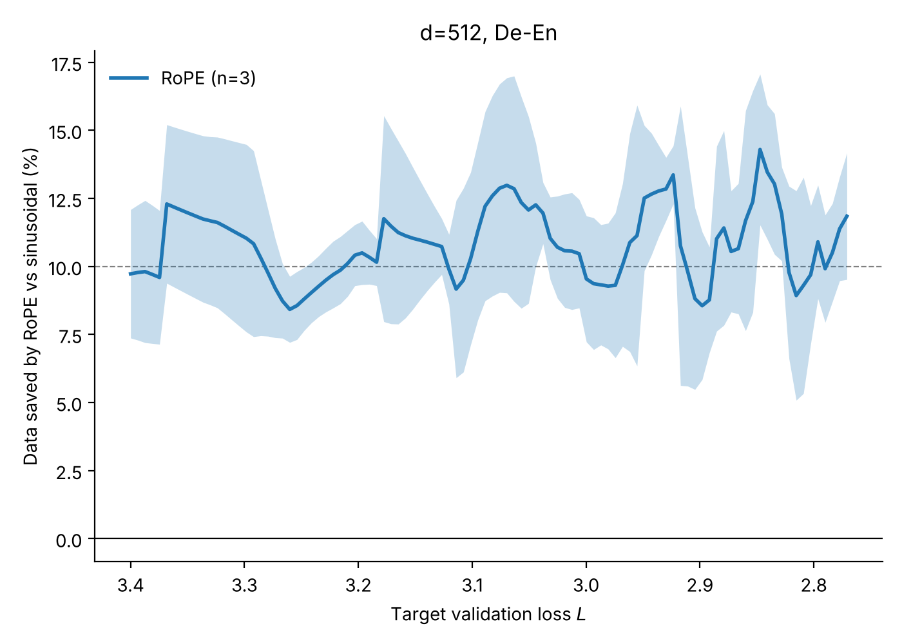
</p>
The n=3 curves are noisier but stay within a few points of their configuration's mean.
</details>

<details>
<summary>Forest plot at w=0.15 and w=0.35</summary>
<p align="center">
  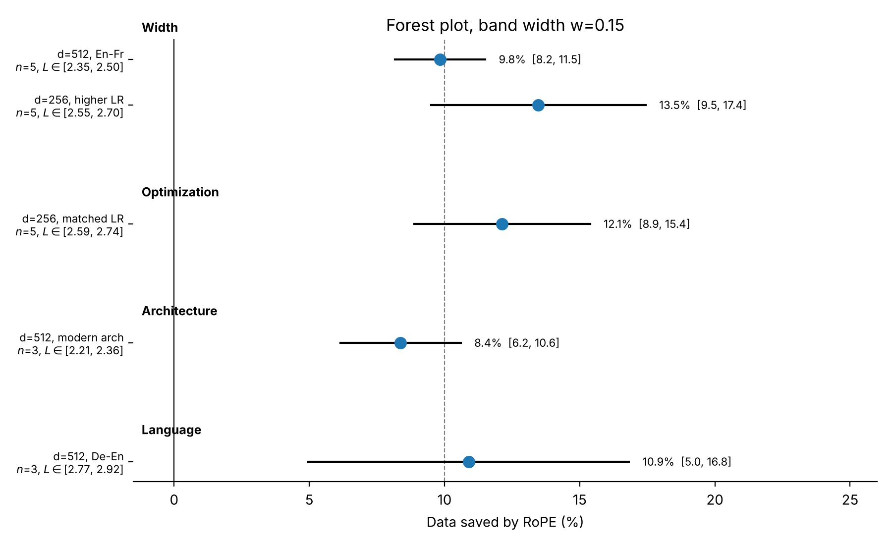
  
</p>
</details>

## 6. Result 2: Locating the baseline

A natural objection is that sinusoidal is a weak baseline. To check, we place all five encodings on the same axes:

<p align="center">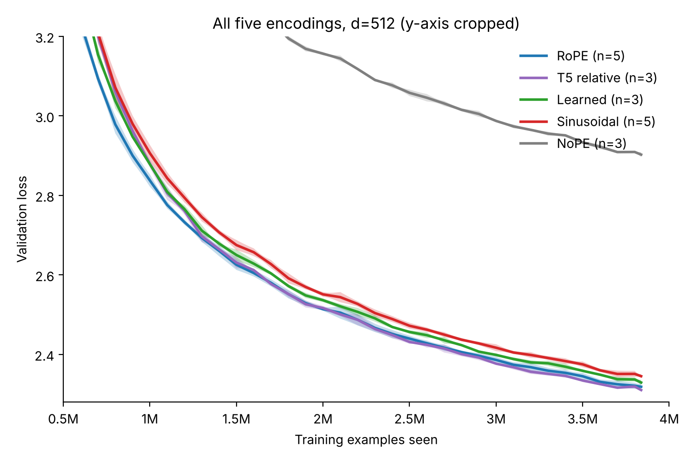</p>

*Figure 3: all five encodings at d=512, En→Fr (y-axis cropped; NoPE stays above the visible range for most of training).*

- **Learned absolute embeddings sit between sinusoidal and RoPE.** They save a roughly constant **5–6%** over sinusoidal (green curve in Figure 4). So sinusoidal is mildly weak.
- **NoPE collapses:** 17.17 BLEU vs 27.67 for sinusoidal. Since our encoder is bidirectional, with no positional signal it is truly permutation-invariant. (Causal decoder-only models can recover position from the attention mask; ours cannot.)

## 7. Result 3: Relative information and how it is obtained

T5 bias makes attention depend on relative offset, just like RoPE does, but it **learns** the mapping instead of fixing it. Comparing the two separates *having* relative information from *how it is acquired*.

<p align="center">
  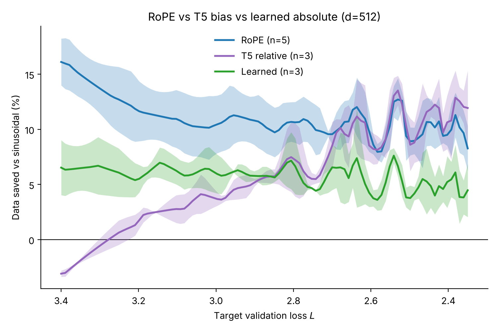
  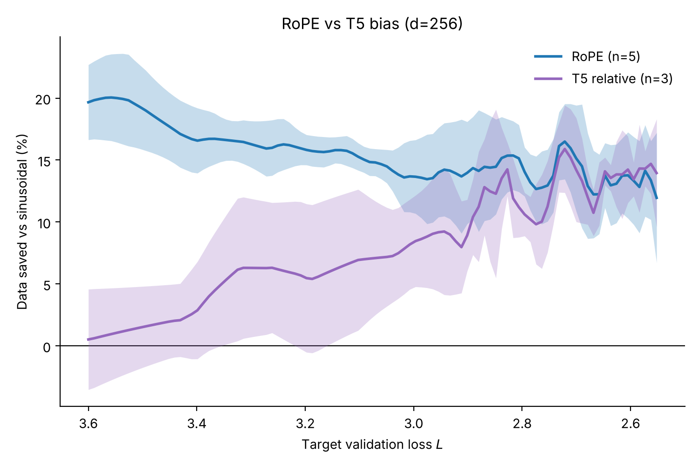
</p>

*Figure 4: data saved over sinusoidal. Left d=512, right d=256. Training progresses left to right.*

- **RoPE is ahead from the first measurable point** and stays ahead.
- **T5 starts *behind sinusoidal*** (about −3% at a loss of 3.4). It rises steadily, crosses zero near a loss of 3.28, reaches RoPE's level around 2.5, and ends statistically indistinguishable from it in loss.
- **The same crossover appears at d=256.**

**Takeaway:** both relative encodings end up more data-efficient than both absolute ones. What differs is *when*: RoPE's efficiency is present from the start, while T5 spends most of training acquiring it.

**Why does T5 start slowly?** At initialization the bias table is tiny (random values with standard deviation 0.02), so T5 attention is effectively position-blind, which explains the start behind sinusoidal. But the table is tiny (32 buckets per head) and gets gradient from every token pair, so initialization alone can't explain a deficit lasting ~2M examples. 

**A practical note.** RoPE modifies q and k *before* attention, so it works with fused kernels like FlashAttention. T5 adds a learned bias to every attention score inside the softmax, which forces PyTorch's SDPA onto its generic path. We did not benchmark speed rigorously but from what we tested it was noticeably slower.

## 8. BLEU

BLEU uses `torchmetrics.text.BLEUScore` (0–100 scale) with greedy decoding on held-out data. 

**Table 4: paired BLEU difference, RoPE − sinusoidal**

| Configuration | n | ΔBLEU [95% CI] |
|---|---|---|
| d=512, En→Fr | 5 | +0.26 [+0.03, +0.49] |
| d=256, higher LR | 5 | +0.34 [+0.00, +0.68] |
| d=256, matched LR | 5 | +0.22 [−0.16, +0.60] |
| d=512, modern arch | 3 | +0.33 [−0.05, +0.71] |
| d=512, En→De | 3 | +0.37 [+0.22, +0.51] |
| **Pooled** | 21 | **+0.30**, sd 0.21 (p < 10⁻⁴; RoPE ahead in 18/21 pairs) |

**Table 5: final BLEU at d=512, matched seeds (n=3)**

| Variant | BLEU (mean ± SD) | vs sinusoidal |
|---|---|---|
| T5 relative | 28.10 ± 0.50 | +0.43 |
| Learned APE | 28.07 ± 0.71 | +0.40 |
| RoPE | 28.00 ± 0.35 | +0.33 |
| Sinusoidal | 27.67 ± 0.51 | — |
| NoPE | 17.17 ± 0.21 | −10.50 |

RoPE, T5 and learned APE are statistically indistinguishable in BLEU (all pairwise p > 0.5). Meanwhile, the data-efficiency gap over sinusoidal is undiminished at the end of training. This is the resolution problem from §2.

> **Note on the BLEU subset.** Validation loss uses the full held-out set (38,948 pairs). BLEU is computed on the first 3,072 sentences produced by the length-bucketed validation loader. Because that loader is not shuffled, these are the 3,072 shortest sentences among the first 12,800 held-out pairs. BLEU therefore over-represents short sentences. This is the same subset for every run, so paired differences remain valid.

## 9. Limitations

- **Scale.** 19–60M-parameter encoder–decoders trained for a single pass. No claims about converged models, larger scales, or causal decoder-only pretraining.
- **Statistics.** Mechanism comparisons use n=3 seeds (T5, learned) against n=5 (RoPE, sinusoidal). The paired statistic uses the seed intersection, so the effective n is 3. Two language pairs are too few to link the effect to word-order properties.
- **Schedule.** The savings are exact under early stopping with the shared schedule, and likely conservative under schedule re-tuning (§3).

### Known deviations and gaps

- **The modern-architecture training code is not included.** The four runs of that configuration (`exp8`, `exp9`: AdamW, warmup–cosine decay, SwiGLU, RMSNorm; 58.9M parameters) are fully logged and included in every analysis, but the code that trained them is not in this repository.

## 10. Reproducing everything

### Figures and tables (CPU, seconds)

All results are stored in [`data/curves.csv`](data/curves.csv): one row per validation checkpoint for each of the 54 training runs (val loss every 100K examples, plus final BLEU).

```bash
pip install numpy pandas scipy matplotlib
python analysis/figures.py   # -> figures/   (every figure)
python analysis/tables.py    # -> results/   (Tables 1, 4, 5)
```

These regenerate the numbers exactly.

### Training (GPU)

```bash
pip install -r requirements.txt
cd src
python run.py --pe rope sinusoidal --seeds 0 1 2 3 4                                    # d=512, En→Fr
python run.py --pe rope sinusoidal --seeds 0 1 2 3 4 --d_model 256 --heads 4             # d=256, higher LR
python run.py --pe rope sinusoidal --seeds 0 1 2 3 4 --d_model 256 --heads 4 --lr_scale 0.7071   # d=256, matched LR
python run.py --pe rope sinusoidal --seeds 0 1 2 --pair de-en --tgt de                   # En→De
python run.py --pe learned nope t5 --seeds 0 1 2                                         # mechanism, d=512
python run.py --pe t5 --seeds 0 1 2 --d_model 256 --heads 4                              # T5, d=256
```

Each run prints the validation loss every 100K pairs and a final BLEU. The first call builds and caches the dataset and tokenizer (~15 min). A d=512 run takes about 15K steps (~50 min on the Colab GPU used). The runs used `--compile`.

### From raw logs to data

[`logs/`](logs/) holds the console output of all 54 original runs, one file per experiment batch. `data/curves.csv` was parsed from these logs, and you can check that yourself:

```bash
python analysis/parse_logs.py --check   # all 2,258 checkpoints match data/curves.csv exactly
```

So every number traces back through **logs → `data/curves.csv` → `analysis/` → figures and tables**.

## 11. Repository layout

```
├── README.md                  ← you are here
├── src/                       training code
│   ├── model.py               encoder–decoder Transformer + all 5 positional encodings
│   ├── dataset.py             filtering, length-bucketed batching
│   ├── train.py               data pipeline, training loop, validation loss, BLEU
│   ├── config.py              hyperparameters
│   └── run.py                 CLI entry point
├── analysis/
│   ├── parse_logs.py          rebuilds data/curves.csv from logs/ (and checks it)
│   ├── data_efficiency.py     the data-saved statistic and the forest-plot estimator
│   ├── figures.py             regenerates every figure
│   └── tables.py              regenerates Tables 1, 4, 5
├── data/
│   ├── curves.csv             every validation checkpoint of every run (54 runs)
│   └── experiments.csv        experiment ID → configuration, seeds, LR, log file
├── results/                   generated tables (CSV)
├── figures/                   generated figures (PNG)
└── logs/                      raw console logs of all 54 training runs (exp1–exp14)
```

**`data/curves.csv` columns:** `exp_id, run_id, variant, seed, d_model, note, checkpoint, is_final_epoch, step, total_steps, pairs_seen, lr, val_loss, bleu`. `bleu` is the run's final BLEU (0–100), repeated on every row of that run. Seeds of one configuration were trained in several batches (`exp_id`s). `analysis/data_efficiency.py` groups them, and pairing is always by seed.
